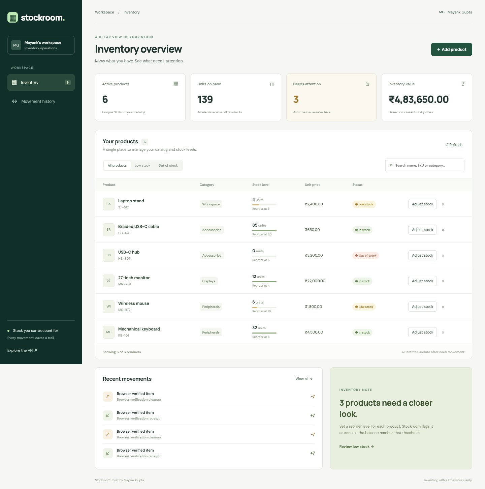
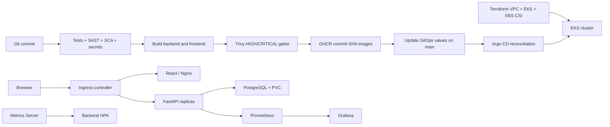

# Stockroom — inventory and stock movement capstone

**Mayank Gupta · 24BCS10220** · [Repository](https://github.com/mayank-0789/Devops-Assignment-1)

Stockroom manages a product catalog, receives and dispatches stock, flags reorder thresholds, and preserves a movement ledger. The application was written for this capstone; the previous imported TicketHub application is no longer the submission application. Shared DevOps scaffolding retains its [source attribution](../SOURCE.md).

## What works and what remains

The original FastAPI API, React dashboard, isolated tests and migrations are implemented. Local validation uses SQLite for fast tests/preview; the submitted Compose stack and the CI integration job use PostgreSQL. Local screenshots are **not AWS deployment evidence**.

The release workflow, Helm/EKS configuration, security gates and GitOps promotion are implemented. A configuration file is not proof of deployment: GHCR publication, EKS apply/destroy, Argo CD synchronization, Ingress, live Prometheus/Grafana and measured HPA scaling must still be demonstrated. Track each requirement in [the acceptance checklist](docs/ACCEPTANCE.md).



Local preview with sample inventory and SQLite; see [verification scope](screenshots/stockroom-local/metadata.json).

## Original application behavior

- Product CRUD: unique immutable SKU, category, price stored as integer paise, reorder level.
- Receive/dispatch stock with a reason; quantity and audit entry commit together.
- Conditional database updates prevent concurrent dispatches from overselling.
- Search by name/SKU/category in the UI; low-stock and out-of-stock filters.
- Archive only zero-stock products; retain their movement history and reserved SKU.
- Health, readiness (including schema availability), OpenAPI and Prometheus endpoints.
- No login/tenant isolation is implemented. This is a classroom inventory app; use sample data for the public demo.

## Run with PostgreSQL and Docker

From `final-devops-project/`:

```bash
docker compose -f docker/docker-compose.yml up --build -d --wait
bash scripts/seed.sh
# UI: http://localhost:3000
# OpenAPI: http://localhost:8000/docs
# Actual database + concurrent transaction smoke check:
python3 scripts/smoke.py
# Stop without deleting the data:
docker compose -f docker/docker-compose.yml down
```

The one-shot migration service waits for PostgreSQL; the API waits for migrations. Both application images run with numeric non-root UIDs. Sample stock values are created only when you explicitly run the seed command. Re-running the seed skips existing SKUs.

## Develop without Docker

Python 3.12+ and Node 22 are required. PostgreSQL remains the submission database. SQLite below is a local preview convenience.

```bash
cd application/backend
python3 -m venv .venv
source .venv/bin/activate
pip install -r requirements-dev.txt
export DATABASE_URL=sqlite:///./preview.sqlite3
python -m app.migrate
uvicorn app.main:app --host 127.0.0.1 --port 8000
```

In a second terminal:

```bash
cd final-devops-project/application/frontend
npm ci
npm run dev
# http://localhost:5173
```

From the capstone directory run `bash scripts/seed.sh` to populate the running API. Vite proxies API, docs and metrics to port 8000.

## Tests and security

```bash
cd application/backend
pytest -v
# From the frontend directory:
npm ci && npm run build
npm audit --audit-level=high
```

Tests exercise CRUD, input constraints, money arithmetic, movement history, insufficient-stock rollback, readiness failure, metrics and the full Alembic migration chain. `scripts/smoke.py` additionally runs concurrent HTTP requests against a live database. CI runs this against PostgreSQL.

[Security checks and evidence](security/README.md) · [Release workflow](../.github/workflows/capstone.yml)

## Architecture and delivery



Terraform runs separately before application delivery. The CI workflow validates infrastructure without creating resources. Pull requests test, scan and build; only successful `main` runs publish and promote. No mutable `latest` images are published. Argo CD watches the values commit and deploys the Helm chart. HPA owns the backend replica count after bootstrap.

See [AWS/GitOps runbook](docs/DEPLOYMENT.md), [troubleshooting exercises](docs/TROUBLESHOOTING.md) and [submission checklist](docs/ACCEPTANCE.md).

## Evidence and provenance

`screenshots/validation*` and the historical `screenshots/application.png` predate Stockroom and validate the old TicketHub lab only. Likewise, historical Terraform screenshots validate an earlier configuration, not the current EKS deployment. Do not submit those as Stockroom execution evidence. `REFERENCE.md` is the attributed older walkthrough, not the current runbook.

Keep fresh evidence tied to the exact commit and Actions run. The rubric requires a meaningful commit history, screenshots, a successful pipeline URL, and a live/recorded commit-to-deployment demonstration. Do not manufacture commits or screenshots to meet the checklist.

The application migration `0002_inventory` adds new tables without deleting the legacy `tickets` table. Existing TicketHub rows are retained but are not displayed by Stockroom. Renamed Compose/Helm resources use a separate Stockroom deployment; no existing deployed cluster was modified during development.

## Assignment sources

- [Session 21 brief](https://github.com/Nency-Ravaliya/devops-heros/blob/main/session21-python/README.md)
- [Grading rubric](https://github.com/Nency-Ravaliya/devops-heros/blob/main/session21-python/GRADING.md)
- [Homework document, Session 21](https://docs.google.com/document/d/1cjXFYf2Thm8cBEN-0C48B-v02cj3jGLd47lcO18prHE/edit)

Submission: put this README's GitHub URL in your section's Session 21 field after the required evidence is complete.
